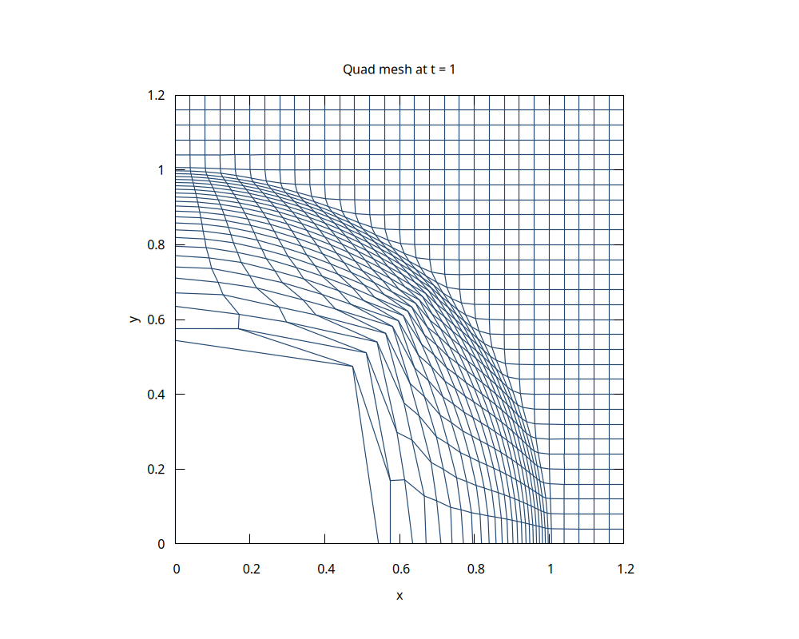
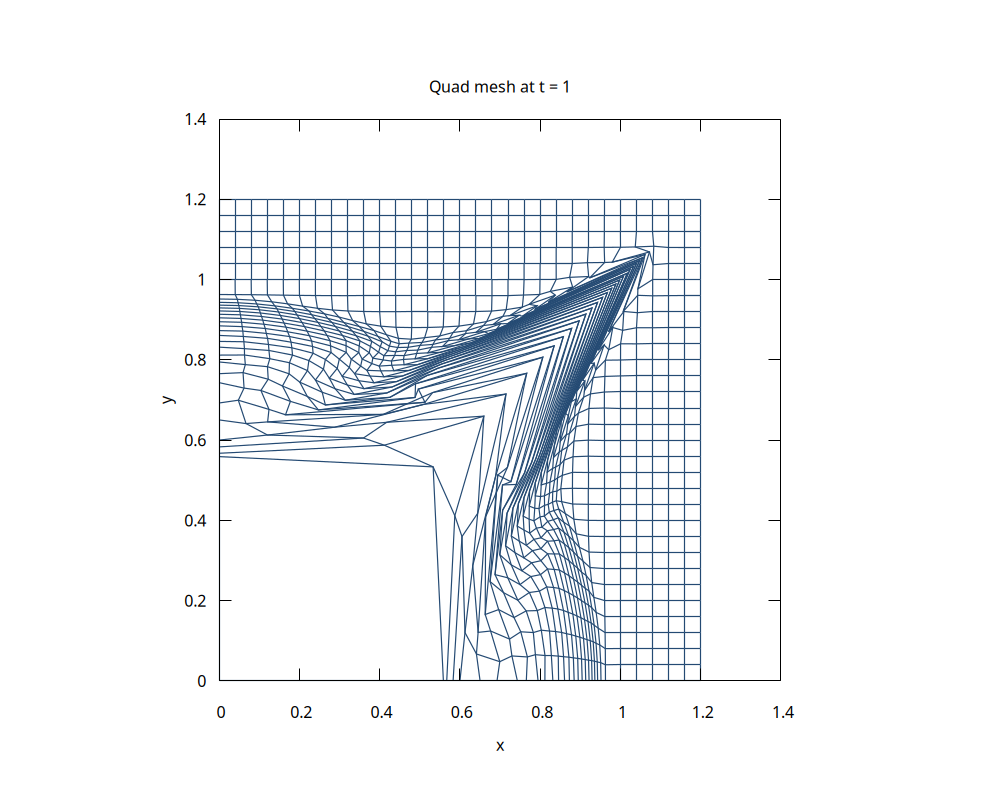
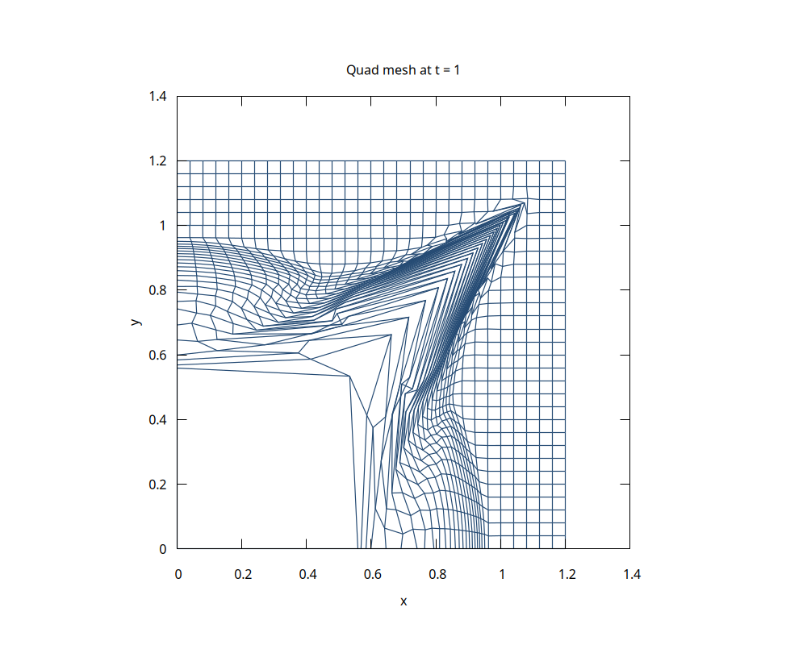
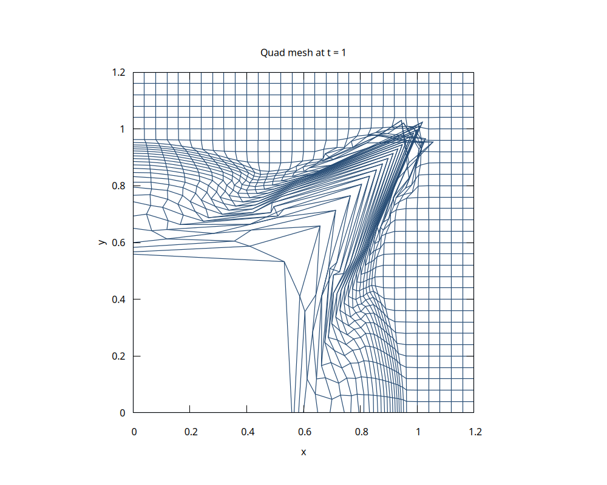

初值与Maire P109 所用一致. 

仅使用CFL 条件, $C_e = 0.25$. 计算478, 393步.

再加上体积变形限制, $C_v = 0.1$. 计算494, 386步.

再加上时间步长增长限制, $C_m = 1.01$. 计算551, 439步.

换个CFL 数, $C_e = 0.5$, 两个格式都炸膛了

Invalid cell volume at step 3, t=0.0055693709080876629, cell=(2,1): -0.00010871612995846532

Invalid cell volume at step 3, t=0.0061663298706183187, cell=(2,1): -0.00027928037940192564

添加 $C_v = 0.1$. 分别用361, 341步.

